# YOLO SigmaChain launch contracts

Status: draft, 2026-11-22. Describes the contracts as they are in this repo. Nothing is deployed on a public network.

This document explains, transaction by transaction, how the five launch contracts move the block reward from the emission box to the miner, the treasury and the liquidity (LP) fund, and how money leaves the two funds.

**Before genesis.** The three signer keys compiled into the two fund contracts today are public test keys. Their secrets are in this repo's test files (for example `02-treasury-tests/tests/keygen.rs`). They must be replaced before genesis. The NFT ids are placeholders in the source (`TREASURY_NFT_ID_PLACEHOLDER` and the like) and are fixed when the genesis state is built.

## The short version

- Five contracts: `01-emission-tests/emission.es`, `02-treasury-tests/treasury_accumulation.es`, `02-treasury-tests/treasury_governance.es`, `03-lp-fund-tests/lp_accumulation.es` and `03-lp-fund-tests/lp_fund.es`.
- Genesis holds three contract boxes, each with a one-unit NFT: the emission box (177,291,250 YOLO, the value the schedule is built for and the one in the node's devnet config), the treasury fund box and the LP fund box (at least 100 YOLO each). The genesis state also holds Ergo's no-premine box.
- Every block up to the final reward (about 20 years) spends the emission box. The miner gets 93 parts in 100, locked for 2,880 blocks (about one day). The treasury accumulation script gets 4 and the LP accumulation script gets 3. The first blocks pay 69.75, 3.0 and 2.25 of a 75 YOLO reward.
- Accumulation boxes need no signature. Anyone may merge old ones. Moving them into a fund box needs two of the three signers.
- Apart from a migration (below), money leaves the treasury only as one recorded payment at a time, payable 8,641 to 28,800 blocks after it is recorded (72 hours to 10 days).
- Apart from a migration (below), money leaves the LP fund only to destinations on its whitelist, and only once an entry is more than 8,640 blocks (72 hours) old. Entries can never be removed while the fund stays at this contract.
- Both funds use the same three keys, two of which must sign every action. Payments and spends cannot take a fund box below 100 YOLO.

## How value moves

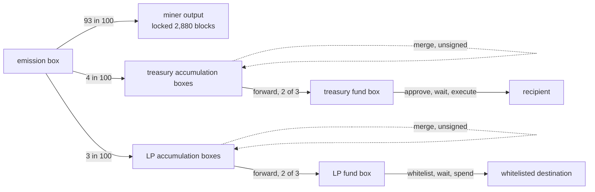

Reading the diagrams below: spent boxes are on the left, created boxes on the right, and `O0`, `O1` are output positions, which the contracts check by index. `′` marks the new copy of a box. No transaction in this document has a data input: the node builds the block reward with none, and `09-fund-signing/fundsign.py` builds every fund transaction with none and refuses to sign one that has any. Miner fee and change outputs are drawn because they sit at fixed positions. "Unsigned" means the contract boxes need no signature.

## Flows

### Block reward

The miner of every block includes this transaction; the YOLO node builds it in `YoloEmissionTx.scala`. It spends the emission box and splits the block reward: 4 parts in 100 to the treasury accumulation script, 3 to the LP accumulation script, and the rest to the miner. The miner's output uses the standard Ergo miner reward script for the key in the block header, with a 2,880-block lock. The reward starts at 75 YOLO, halves every 1,051,200 blocks (one year) five times down to 2.34375 YOLO, and is 1.5 YOLO from height 6,307,200 on.

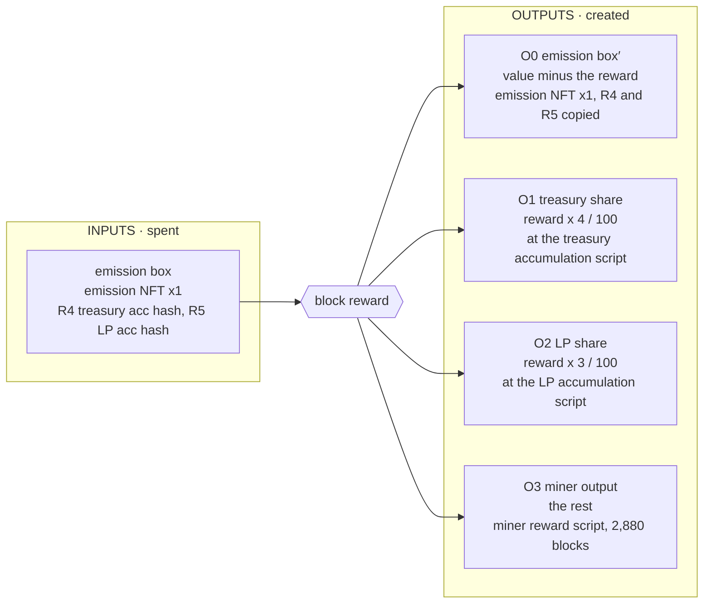

| What the contract checks | |
|---|---|
| The emission box | holds the emission NFT at tokens(0), amount 1, and was created in an earlier block |
| Outputs | exactly four |
| O0 | same script, value lowered by exactly the reward, exactly one token (the NFT), R4 and R5 copied, no R6, created at this height |
| O1, O2 | exact share values, script hash equal to R4 and R5 of the emission box, no tokens, no registers, created at this height |
| O3 (last output) | the miner reward script for the block header key with a 2,880-block lock, the exact remainder, no tokens, created at this height |

### Final block reward

When the emission box holds no more than one block reward, the node builds the terminal form instead. The whole remaining value is split 4 / 3 / 93 in the same way, nothing is left in an emission box, and the emission NFT is burned. With a genesis value of 177,291,250 YOLO (the devnet config's value) this happens once, at height 21,023,916 (about 20 years), on a box of 1.0 YOLO.

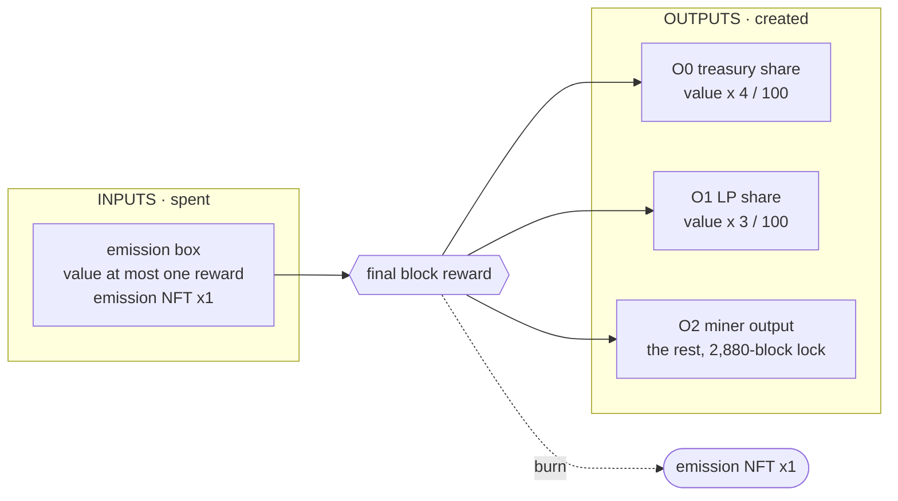

| What the contract checks | |
|---|---|
| Path | the emission box value is at most the reward at this height |
| Outputs | exactly three; O0 and O1 as the share outputs above, the last output as the miner output above |
| NFT | no output holds the emission NFT |

### Merge accumulation boxes (keeper)

Anyone may merge accumulation boxes of one fund into a single box at the same script; the accumulation boxes need no signature. Every box merged must hold no tokens and be more than 20,160 blocks old (about 7 days), and the merged box must hold at least their total, with no tokens and no registers. The keeper pays the fee from a separate input. No tool builds this transaction yet; the diagram follows the layout given in the contract header. The test `coinbase_to_fund_end_to_end` in `05-integration-tests` checks the merge itself (two boxes into one, refused inside the cooldown, accepted after it).

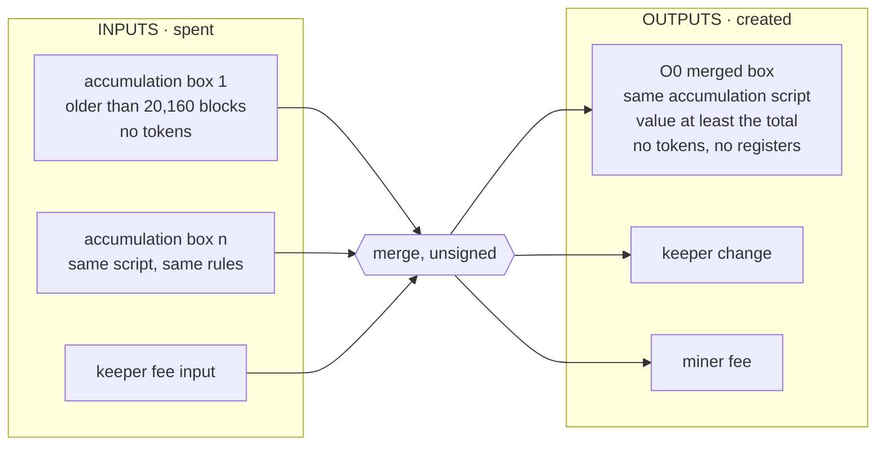

| What the contract checks (run once per accumulation box) | |
|---|---|
| This box | no tokens, created more than 20,160 blocks before this height |
| O0 | at this script, value at least the total of all inputs at this script, no tokens, no R4, created within the last 10 blocks |

### Forward into a fund

Two signers move accumulation boxes into their fund box with `fundsign.py build treasury forward` or `fundsign.py build lp forward`. The fund box is input 0, and its new copy carries its old value plus every accumulation box spent, with all registers unchanged. The proposer pays the fee, so nothing leaves the fund. A forward is refused while the fund is frozen.

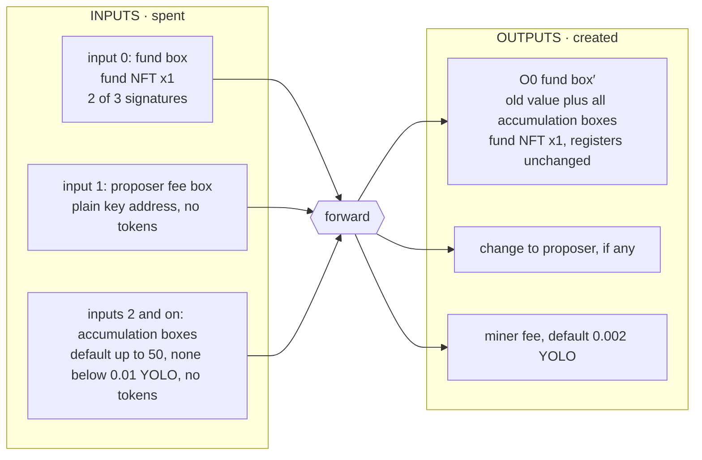

| What the contracts check | |
|---|---|
| Accumulation side | input 0 and O0 hold the fund NFT at tokens(0), amount 1; input 0 is not at the accumulation script; O0 value is at least the total of all inputs at the accumulation script or at input 0's script |
| Fund side | two of three signatures; not frozen; O0 at the fund script with the NFT, value at least the fund box value, registers unchanged, created no more than 720 blocks before inclusion |

### Treasury: approve a payment

Two signers record one payment: a recipient script, an amount, a hash binding the two, and the current height. Only one payment can be recorded at a time, and only while the treasury is in the normal state. The recorded height must be within 10 blocks of the block that includes the transaction, so both signers must finish the round within about 5 minutes. Afterwards the treasury box shows the recorded payment; nothing has been paid yet.

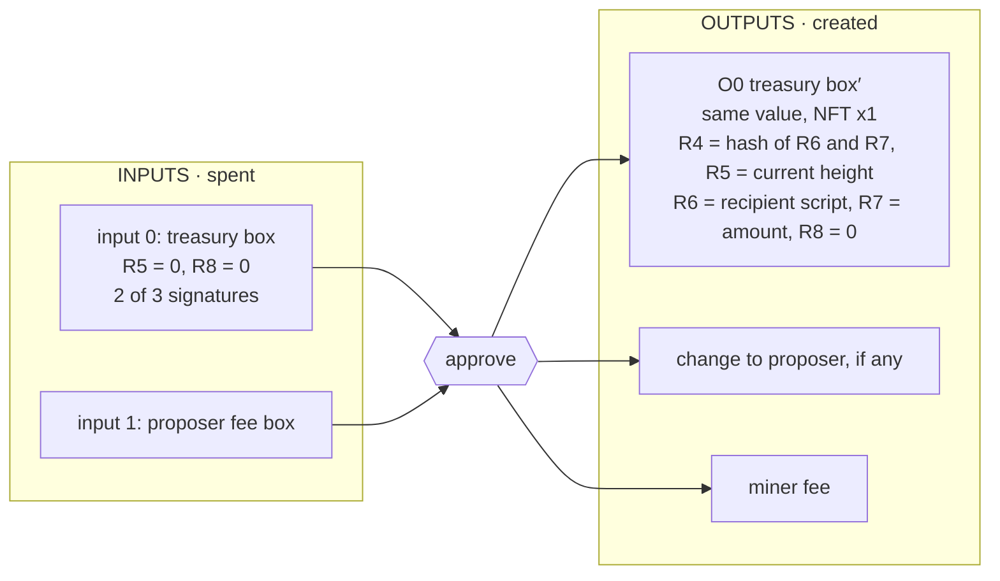

| What the contract checks | |
|---|---|
| Before | state 0 (normal) and nothing recorded (R5 = 0) |
| O0 | at the fund script with the NFT, value at least the old value; R8 = 0; R5 above 0 and within the last 10 blocks; R4 = blake2b256 of R6 followed by R7 as 8 bytes |

### Treasury: execute the payment

After the wait, two signers pay the recorded payment. It can be included from 8,641 blocks after the recorded height up to 28,800 blocks after it (72 hours to 10 days); after that it can only be cancelled. The fee comes out of the treasury, so the treasury box is the only input. The recipient should see a new box at their address holding the amount.

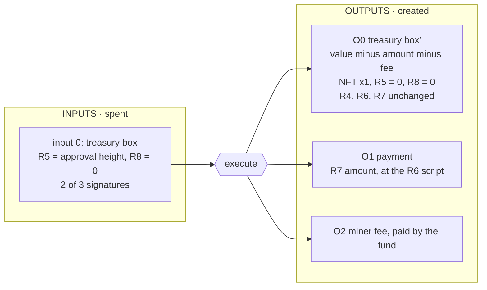

| What the contract checks | |
|---|---|
| Before | state 0, a payment recorded, height inside the window, R4 still matches R6 and R7 |
| O1 | at the R6 script, value at least R7 |
| After O1 | at most one more output, at the standard miner fee script, at most 0.01 YOLO |
| O0 | at the fund script with the NFT, value at least the old value minus R7 and the fee, at least 100 YOLO (or the old value if lower), R5 = 0, R8 = 0, other registers unchanged |

### Treasury: cancel

Two signers clear a recorded payment, or a recorded migration approval. The approval height goes back to 0; the old recipient, amount and hash stay in the box but can no longer be paid. This is the only way to clear an expired payment before approving a new one.

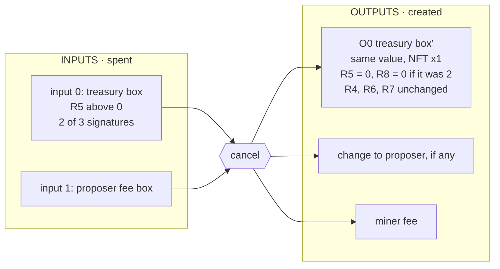

| What the contract checks | |
|---|---|
| Before | something is recorded (R5 above 0), in any state |
| O0 | fund script, NFT, value at least the old value; R5 = 0; R8 = 0 if it was 2, otherwise unchanged; R4, R6, R7 unchanged |

### Freeze and unfreeze (both funds)

Two signers can freeze either fund and later unfreeze it; the flag is R8 on the treasury and R5 on the LP fund. While frozen, the treasury cannot approve or execute a payment, the LP fund cannot spend or add destinations, and neither takes in forwards, so new shares wait at the accumulation script. A treasury payment approved before a freeze keeps its window, and the window keeps running during the freeze.

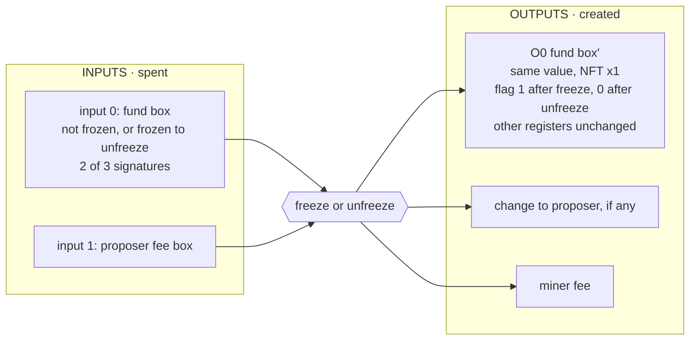

| What the contract checks | |
|---|---|
| Freeze | the fund is not already frozen; O0 kept with the flag set to 1 |
| Unfreeze | the fund is frozen; O0 kept with the flag set to 0 |
| Both | O0 at the fund script with the NFT, value at least the old value, other registers unchanged |

### LP fund: add destinations to the whitelist

Two signers add one or more destinations to the LP fund's whitelist. Each entry is the blake2b256 hash of a destination script and the height it was added, and it becomes usable 8,641 blocks later (72 hours). Entries can never be removed or changed, and the list holds at most 64 entries. As with a treasury approval, the recorded height must be within 10 blocks of inclusion, so both signers work through the round together.

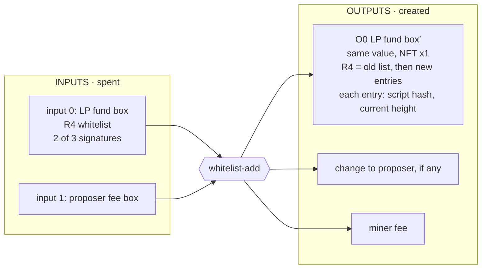

| What the contract checks | |
|---|---|
| Before | not frozen |
| O0 | kept (fund script, NFT, value at least the old value); R5, R6, R7 unchanged; the old list is an unchanged prefix of the new one |
| New entries | at least one; each a 32-byte hash with a height above 0 and within the last 10 blocks; 64 entries at most in all |

### LP fund: spend to a listed destination

Two signers pay an amount to a destination whose whitelist entry is more than 8,640 blocks old. There is no further wait and no per-payment approval: once an entry has matured, a spend to it needs only two signatures. The fee comes out of the fund, and the fund box must keep at least 100 YOLO. The destination should see a new box holding the amount.

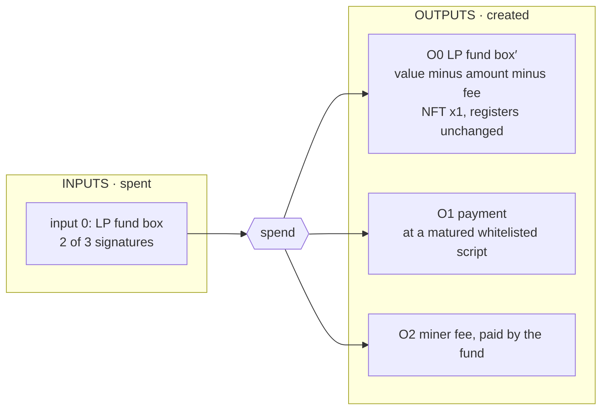

| What the contract checks | |
|---|---|
| Before | not frozen |
| O0 | at the fund script with the NFT, registers unchanged, value at least 100 YOLO (or the old value if lower) |
| Every later output | either at a script whose hash is a whitelist entry added more than 8,640 blocks ago, or a miner fee output of at most 0.01 YOLO; at most one fee output |

### Migration (in the contracts, not signed by the tool)

Both fund contracts have a migration path: two signers record the hash of a target script, and after the same 8,640-block wait and inside the same 20,160-block window, two signers may move the fund box, NFT included, to that script, keeping all but at most 0.001 YOLO. A recorded migration approval can be cancelled (treasury `cancel`, LP `cancel`). `fundsign.py` refuses to sign a migration approval or a migration; it signs only the cancel. No tool builds a migration, so the diagram is taken from the contract.

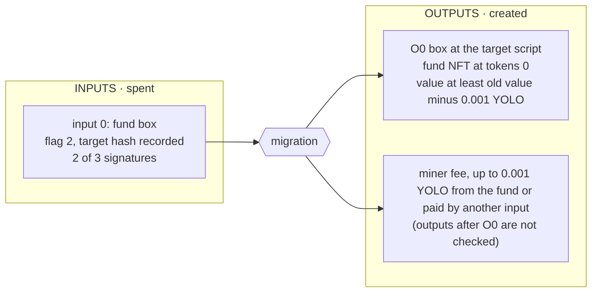

| What the contract checks | |
|---|---|
| Approval | state 0 (treasury: nothing recorded either); flag set to 2, the approval height within the last 10 blocks, a 32-byte target script hash recorded |
| Execute | flag 2; height inside the same window as a payment; O0's script hash equals the recorded hash; O0 holds the fund NFT at tokens(0); O0 value at least the old value minus 0.001 YOLO |
| Arrival | to another script, O0's state and approval-height registers must be 0 or absent; to the same script, O0 arrives in the normal state with nothing recorded |

## Limits and timings

All block counts at 30 second blocks.

| Limit | Value | Set in | Time |
|---|---|---|---|
| Halving interval | 1,051,200 blocks | `emission.es` `blocksPerHalving` | 365 days |
| Rewards | 75, 37.5, 18.75, 9.375, 4.6875, 2.34375, then 1.5 YOLO | `emission.es` `initialReward`, `minReward` | floor from height 6,307,200, about 6 years |
| Last emission spend | height 21,023,916, for a 177,291,250 YOLO genesis box | node `YoloEmissionRules.scala` | about 20 years |
| Miner output lock | 2,880 blocks | `emission.es` miner script, node `YoloEmissionTx.scala` | about 1 day |
| Merge cooldown | more than 20,160 blocks since the box was created | accumulation `cooldownBlocks` | 7 days |
| Merged box creation height | within 10 blocks of inclusion, so a merged box can be merged again after 20,150 | accumulation contracts | 5 minutes |
| Fund wait | 8,640 blocks; usable from the 8,641st | fund `timelockBlocks` | 72 hours |
| Treasury payment window, both migration windows | 20,160 blocks after the wait, so up to 28,800 after the recorded height | fund `windowBlocks` | 7 days, 10 days in all |
| Recorded height slack | within 10 blocks of inclusion | fund `heightSlack` | 5 minutes |
| Signing window | fund box copy created no more than 720 blocks before inclusion | fund `signWindow` | 6 hours |
| Fund floor | 100 YOLO, or the current value if already lower | fund `fundFloor` | |
| Fee paid by the fund | at most 0.01 YOLO, one output | treasury `feeCap`, LP `spendFeeCap` | |
| Migration value slack | 0.001 YOLO | fund `migrationFeeCap` | |
| Whitelist size | 64 entries | LP `maxWhitelist` | |
| Genesis whitelist entries | height 0, usable from block 8,641 | node `YoloGenesis.scala`, `lp_fund.es` | 72 hours after genesis |
| Storage rent age | 1,051,200 blocks unmoved | node `Constants.StoragePeriod` | about 1 year |
| Tool defaults | fee 0.002 YOLO, 50 boxes per forward, skip boxes below 0.01 YOLO | `fundsign.py` | |

## What signers and keepers should know

- **Two of three, same keys for both funds.** Every fund action needs two of the three keys, and the treasury and LP fund contracts hold the same three. Today these are the public test keys; they must be replaced before genesis. The node's start-up check refuses these three public test keys in either fund contract unless `allowTestSignerKeys = true`, a setting only the devnet config uses; with it set, the node logs an error at every start.
- **Who pays the fee.** The proposer pays from a plain key box for forward, freeze, unfreeze, approve, cancel and whitelist-add. The fund pays for treasury execute and LP spend. `cosign` refuses if the second signer's wallet could sign the fee box.
- **How long a round may take.** Approve and whitelist-add must reach a block within 10 blocks (about 5 minutes) of being built. Other actions have 720 blocks (about 6 hours); execute also stops at the end of its window.
- **Forwards grow in cost faster than in size.** Each accumulation box's script reads every input of the transaction, so the cost of a forward grows roughly with the square of the number of boxes. On a test chain on 24 November 2026, at the launch settings (relay cost limit 1,000,000, block cost limit 1,500,000), a forward of 189 boxes confirmed for each fund, and one of 190 boxes was refused at cost 1,004,788. The relay limit is `maxTransactionCost` in `yolo-testnet.conf`. The tool forwards up to 50 by default (`--max-boxes`).
- **The box count grows by 2,880 a day per fund.** Each block adds one box to each accumulation script. A keeper merge turns old boxes into one, and a merged box can be forwarded at once, because forwarding has no cooldown.
- **Dust is skipped.** `forward` skips boxes below 0.01 YOLO by default (`--min-box`), which is below every block share: the smallest is the LP share at the 1.5 YOLO floor, 0.045 YOLO, and the final LP share is 0.03 YOLO.
- **A freeze stops forwards too.** While a fund is frozen, shares pile up at its accumulation script.
- **Do not send coins to a fund address.** A box at a fund script without the fund NFT can never be spent by the signers; only storage rent can reach it, after 1,051,200 blocks. Deposits go to the accumulation address.
- **What cannot be undone.** An executed payment, an LP spend, and a whitelist entry. Whitelist entries can never be removed, so 64 additions is the limit while the LP fund stays at this contract. A matured entry can receive a spend at any later time, unless the fund is frozen, with two signatures.
- **What can be undone.** A recorded treasury payment, and a migration approval on either fund, by `cancel`. An expired payment must be cancelled before a new one can be approved.
- **Keepers.** A merge needs no fund keys, only boxes older than 20,160 blocks and a fee input of the keeper's own. No tool builds it yet.

## Contracts

### Emission: `01-emission-tests/emission.es`

Guards the single emission box, identified by the emission NFT at tokens(0). No signature; what it allows is fixed by the height and the box value.

| Register | Type | Meaning |
|---|---|---|
| R4 | `Coll[Byte]` | blake2b256 of the treasury accumulation script. Copied, never changed; written once at genesis |
| R5 | `Coll[Byte]` | blake2b256 of the LP accumulation script. Same |

Constants: `blocksPerHalving` 1,051,200; `initialReward` 75 YOLO; `minReward` 1.5 YOLO; `emissionNftId`; the miner reward script with a 2,880-block lock.
Paths: normal, four outputs (successor, treasury share, LP share, miner); terminal, three outputs (treasury share, LP share, miner) with the NFT burned.

### Treasury accumulation and LP accumulation: `02-treasury-tests/treasury_accumulation.es`, `03-lp-fund-tests/lp_accumulation.es`

One contract in two copies that differ only in the NFT id they name (`treasuryNftId` or `lpNftId`). Guards the share boxes paid by each block. No registers, no signature.
Constants: the fund NFT id; `cooldownBlocks` 20,160.
Paths: consolidation, a keeper merge into one box at the same script; transfer, a forward into whichever box is input 0 and holds the fund NFT at tokens(0). Because the destination is named by NFT, the stream follows the NFT.

### Treasury fund: `02-treasury-tests/treasury_governance.es`

Guards the treasury box, identified by the treasury NFT at tokens(0). Every path needs two of three signatures. The three signer keys in this file today are public test keys and must be replaced before genesis; `treasuryNftId` is fixed when the genesis state is built.

| Register | Type | Meaning |
|---|---|---|
| R4 | `Coll[Byte]` | payment: blake2b256 of R6 followed by R7 as 8 bytes; migration: hash of the target script. 32 zero bytes at genesis |
| R5 | `Long` | approval height, 0 when nothing is recorded |
| R6 | `Coll[Byte]` | payment recipient script; empty during a migration approval |
| R7 | `Long` | payment amount in nanocoins; 0 during a migration approval |
| R8 | `Long` | state: 0 normal, 1 frozen, 2 migration approved |

Constants: three signer keys, threshold 2; `treasuryNftId`; `timelockBlocks` 8,640; `windowBlocks` 20,160; `heightSlack` 10; `signWindow` 720; `feeCap` 0.01 YOLO; `migrationFeeCap` 0.001 YOLO; `fundFloor` 100 YOLO; the standard miner fee script.
Paths: 1 approval; 2 execution; 3 cancellation; 4 consolidation, used by forwards; 5 freeze; 6 unfreeze; 7 migration approval; 8 migration execute, to this script or another.

### LP fund: `03-lp-fund-tests/lp_fund.es`

Guards the LP fund box, identified by the LP NFT at tokens(0). Every path needs two of three signatures. The three signer keys in this file today are public test keys and must be replaced before genesis; `lpNftId` is fixed when the genesis state is built.

| Register | Type | Meaning |
|---|---|---|
| R4 | `Coll[(Coll[Byte], Long)]` | whitelist: (blake2b256 of a destination script, height added); genesis entries have height 0 |
| R5 | `Long` | state: 0 normal, 1 frozen, 2 migration approved |
| R6 | `Long` | migration approval height, 0 when none |
| R7 | `Coll[Byte]` | migration target script hash; 32 zero bytes at genesis |

Constants: three signer keys (the same as the treasury's), threshold 2; `lpNftId`; `timelockBlocks` 8,640; `windowBlocks` 20,160; `heightSlack` 10; `signWindow` 720; `maxWhitelist` 64; `fundFloor` 100 YOLO; `migrationFeeCap` 0.001 YOLO; `spendFeeCap` 0.01 YOLO; the standard miner fee script.
Paths: 1 spend; 2 whitelist update; 3 consolidation, used by forwards; 4 freeze; 5 unfreeze; 6 migration approval; 7 migration cancel; 8 migration execute, to this script or another.

## How to check this yourself

| Flow | Tests |
|---|---|
| Block reward, final block reward | `01-emission-tests/tests/emission_test.rs`; `05-integration-tests/tests/integration_test.rs` modules `test1` to `test10` |
| Keeper merge, forward | `phase8_accumulation` in `02-treasury-tests/tests/treasury_test.rs`, `phase7_accumulation` in `03-lp-fund-tests/tests/lp_fund_test.rs`, `test11_pipeline` in `05-integration-tests` |
| Treasury approve, execute, cancel, freeze, migration | `treasury_test.rs` modules `phase2_approval` to `phase7_migration` |
| LP spend, whitelist, freeze, migration | `lp_fund_test.rs` modules `phase2_spend` to `phase6_migration` |
| Signing tool | `09-fund-signing/test_fundsign.py`, run with `python3 -I test_fundsign.py` (offline) |

The Rust suites run with `cargo test --release -- --nocapture` in each test folder (as given in `01-emission-tests/README.md`; needs Rust 1.85 or later). They load the compiled trees from the `trees/` folders of `01-emission-tests`, `02-treasury-tests` and `03-lp-fund-tests`, which are built with test NFT ids; the integration suite also loads one DAO contract tree from `05-integration-tests/trees`.

To compile the five contracts and compare them with those trees, run `python3 gen_trees.py --check` in `05-integration-tests/compile`. It needs scala-cli and a JVM and talks to no node. `python3 gen_trees.py --ids EMISSION=<id> TREASURY=<id> LP=<id>` compiles with real NFT ids and prints the trees and the two hashes for the emission box's R4 and R5, without writing anything.
